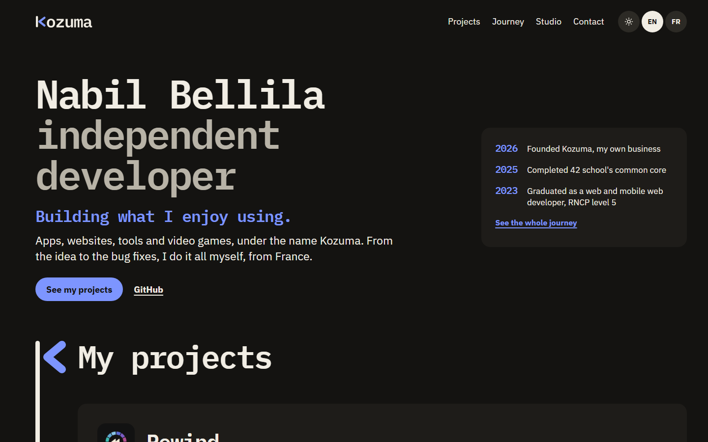

# Kozuma

My personal site, where I show what I make under the name Kozuma: apps, websites, tools and games.

**Live at https://kozuma.studio**



## What's on it

- my projects, with Rewind's real story cards you can scroll or drag with the mouse
- my journey, from my first week of code to now, built from a small list in `carnet.js`
- a contact section, a legal notice and a privacy page
- English and French, and a light / dark theme, both remembered in the browser

It's plain HTML, CSS and JavaScript, no framework and no build step. The fonts (IBM Plex) are hosted on
the site itself so nothing goes to Google Fonts, and the only outside script is Cloudflare's Web Analytics
(no cookies), which Cloudflare adds on its side.

## Hosting

The site runs on Cloudflare Workers as static assets. `wrangler.jsonc` serves the repo root and
Cloudflare deploys it on every push to `main`.

- `_headers`: security headers, including the Content Security Policy
- `_redirects`: `kozuma.studio/rewind` (the short link printed on Rewind's cards) forwards to
  https://rewind.kozuma.studio
- `.assetsignore`: files that stay out of the published site, like this README

## Running it locally

```
python -m http.server
```

then open http://localhost:8000. `_headers` and `_redirects` only apply on Cloudflare.

- `index.html`: the homepage, styles and scripts included
- `carnet.js`: the entries of the journey section
- `legal/`, `privacy/`, `404.html`: the other pages, they reuse the homepage's head, header and footer
- `fonts/`, `img/`: fonts and images
